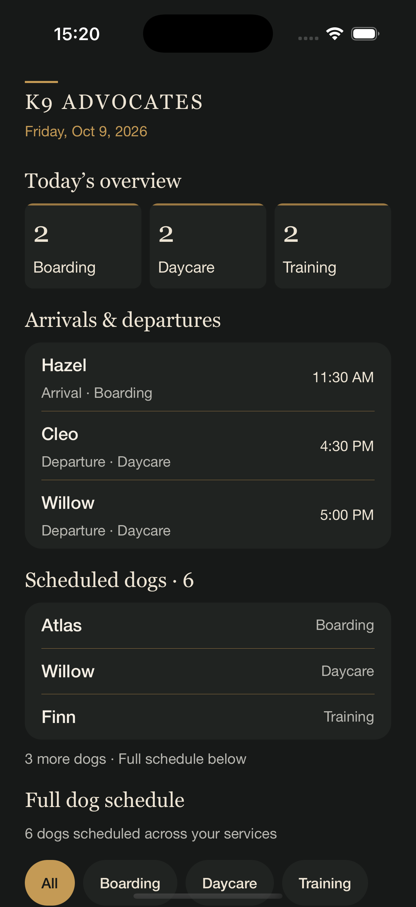
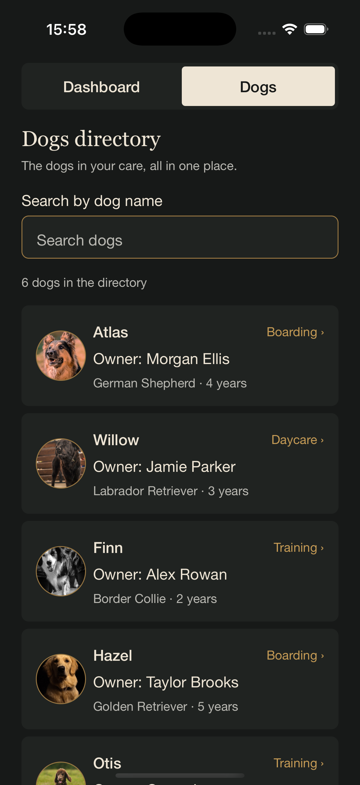
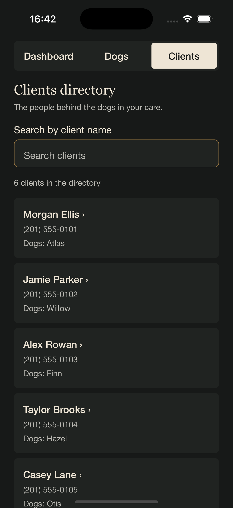
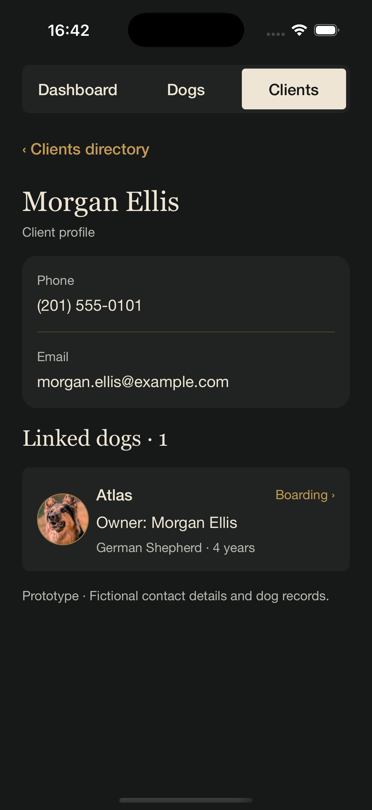
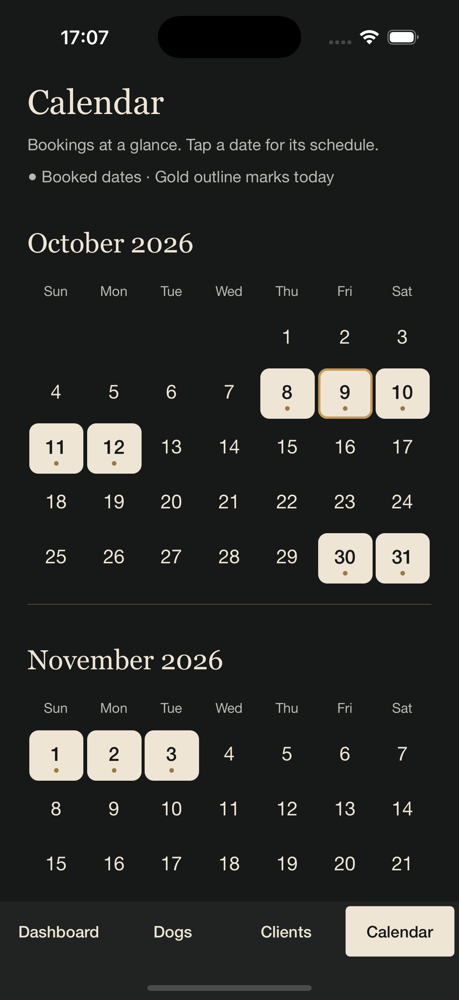
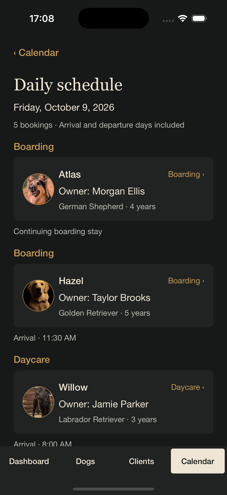

# K9 Advocates Mobile

An internal iPhone app for **K9 Advocates LLC**, a dog training, boarding, and daycare business. The app is designed for the business's administrators and is being developed as a public software development and QA portfolio project.

> **Project status: Early development (v0.4).** Project planning began on October 9, 2026. A prototype with a dashboard, a Dogs Directory, a Clients Directory, and a booking calendar runs in the iOS Simulator using fictional sample data. It is not yet connected to a backend or real data, and client/dog records cannot be added or edited. The v0.5 Add Booking demo supports new bookings in memory for the current app session only. All other features below are planned.

## App Preview

<p align="center">
  
  
</p>

<p align="center">
  
  
</p>

<p align="center"><em>Earlier prototypes: Dashboard v0.1, Dogs Directory v0.2, and Clients Directory and profile v0.3. These captures show the earlier top navigation.</em></p>

<p align="center">
  
  
</p>

<p align="center"><em>Calendar and Daily Schedule v0.4 on the iPhone 16 Pro simulator. All bookings, clients, and dogs shown are fictional sample data.</em></p>

## Current Prototype

- **Dashboard (v0.5 demo):** today's unique-dog service counts and one Today’s Dogs card per stable dog ID, with each booking’s service and arrival/departure times retained. Service filters keep all bookings for matching dogs visible. Uses the same fictional session bookings as Calendar and today in America/New_York.
- **Dogs Directory (v0.2):** six fictional dogs, search by dog name, and read-only dog profiles with circular photos. Dogs without a photo show their initial.
- **Clients Directory (v0.3):** six fictional clients, search by client name, and read-only client profiles with phone, email, and linked dogs.
- **Dog and owner links (v0.3):** a dog's profile links to its owner, and a client's profile links to each of their dogs.
- **Calendar (v0.4):** months shown in a vertical scroll with booked dates highlighted. Tap a date to see its Daily Schedule grouped by dog, with separate booking details including arrivals, continuing boarding stays, and departures, and open a dog's profile from there. Existing bookings are fictional and read-only; new demo bookings can be added for the current session.
- **Navigation:** a bottom tab bar to switch between Dashboard, Dogs, Clients, and Calendar.

## Technology

| Area | Selection | Status |
|---|---|---|
| Framework | React Native | Selected |
| Toolchain | Expo | Selected (SDK 57) |
| Language | TypeScript | Selected |
| Backend architecture | — | Not yet decided |
| Cloud database | — | Not yet decided |
| Authentication service | — | Not yet decided |

## Planned Features

| Feature | Status |
|---|---|
| Administrator authentication | PLANNED |
| Business dashboard | IN PROGRESS (v0.1 prototype with sample data) |
| Client and dog profiles | IN PROGRESS (read-only dog profiles in v0.2 and client profiles in v0.3, with sample data) |
| Booking calendar | IN PROGRESS (v0.4 read-only calendar with sample bookings; capacity and website booking planned, see [Roadmap](#roadmap)) |
| Boarding, daycare, and training management | PLANNED |
| Payments and tips | PLANNED |
| Website inquiry management | PLANNED |
| Synchronization with the K9 Advocates desktop Hub | PLANNED (future) |
| Apple Calendar integration | PLANNED (future) |
| Quo integration | Possible future feature (not in initial MVP) |
| Customer portal | Possible later phase |

## Roadmap

**Calendar** (v0.4 released; remaining items planned)

- [x] A dedicated Calendar tab.
- [x] A vertically scrolling monthly booking calendar.
- [x] Days with bookings highlighted.
- [x] Tap a date to see every dog scheduled that day, including overnight stays, arrivals, and departures.
- [ ] Boarding-capacity indicators.
- [ ] Website booking integration.

The existing K9 Advocates desktop Hub (Python/Streamlit with SQLite) is a separate project. Any future connection to it would go through a secure backend.

## Design Direction

The app will follow the existing K9 Advocates brand identity: warm cream, charcoal, and muted gold tones, elegant typography, and German Shepherd imagery, presented through native iPhone navigation and mobile-friendly layouts.

## Setup

Running the app on the iOS Simulator requires a Mac with Xcode installed, plus Node.js and npm.

```bash
git clone https://github.com/lalacbr11/k9-advocates-mobile.git
cd k9-advocates-mobile
npm install
npm run ios
```

`npm run ios` starts the Expo development server and opens the app in the iOS Simulator using Expo Go.

## Inspect the v0.5 Add Booking demo

Run `npm run ios`, then tap **Add Booking** on Dashboard or Calendar. To preselect a
specific date, tap that date in Calendar and use **Add Booking** on its Daily Schedule.
Dashboard defaults to today in New York.

Choose a fictional dog and service, set native dates/times, optionally add notes,
and tap **Save Booking**. Overlaps require acknowledgement in the form. Checks run
against the fictional session collection; there are no simulated conflict results.
Saved demo bookings update Dashboard, Calendar, and Daily Schedule together.
Bookings and notes disappear when the app reloads or restarts. Nothing is saved to
SQLite, a backend, or the desktop Hub. No new edit/cancel UI is included.

For a repeatable warning example, choose Willow, Dog Daycare, October 9, 2026,
9:17 AM–4:43 PM. Expand **View Existing Booking** and review the fictional overlap.
Also try saving an empty form, collapsing/reopening notes, and backing out after
changing a selection. Native visual/keyboard review is still required before approval.

The only new dependency is the SDK-compatible native date/time picker included in
Expo Go. Time values retain arbitrary minutes and are validated in New York; DST
gaps and repeated fall-back times are rejected rather than silently converted.

## Screenshots

See [App Preview](#app-preview) for genuine iPhone 16 Pro simulator captures of the dashboard, Dogs Directory, Clients Directory, a client profile, Calendar, and Daily Schedule.

## Development Approach

This project is developed and maintained by **Laura Neugebauer**, using AI-assisted development and documentation.

AI tools support planning, coding, troubleshooting, and QA documentation. Laura directs the project, makes development decisions, and reviews and verifies the work.

## Data and Privacy

This repository is public. It does not contain, and must never contain, real customer information, production databases, credentials, API keys, or other secrets. All examples and test data are fictional.

Before declaring development work complete or committing, run `npm run privacy`,
`npm test`, and `npx tsc --noEmit`. Review warnings and resolve failures.
`npm run privacy:history` also scans reachable local Git history. These are manual
commands, not an enforced Git hook. See [repository privacy guidance](docs/REPOSITORY_PRIVACY.md)
for protected exports, the permitted SQL migration directory, and scan limitations.

## Documentation

- [CHANGELOG.md](CHANGELOG.md): notable changes and milestones
- [docs/DEVELOPMENT_LOG.md](docs/DEVELOPMENT_LOG.md): development history and technical decisions
- [docs/qa/](docs/qa/): QA test records
- [tests/README.md](tests/README.md): how to run the automated tests (`npm test`)

## Photo Credits

The dog photos represent fictional dogs only and do not show actual K9 Advocates clients. They are from [Pexels](https://www.pexels.com/) and used under the [Pexels License](https://www.pexels.com/license/). Credits are given voluntarily and do not imply endorsement by the photographers.

| Fictional dog | Photographer | Source |
|---|---|---|
| Atlas | Nano Erdozain | [Pexels](https://www.pexels.com/photo/close-up-of-a-german-shepherd-dog-18058222/) |
| Willow | Eduardo López | [Pexels](https://www.pexels.com/photo/portrait-of-black-labrador-retriever-16618519/) |
| Finn | Jay's Photography | [Pexels](https://www.pexels.com/photo/border-collie-in-black-and-white-16471124/) |
| Hazel | Zach Ward | [Pexels](https://www.pexels.com/photo/portrait-of-golden-retriever-16876004/) |
| Otis | JacLou- DL | [Pexels](https://www.pexels.com/photo/happy-brown-standard-poodle-in-green-field-34265054/) |

## License and Brand Ownership

No software license has been granted. K9 Advocates LLC retains its rights to the business name, logo, and original branded assets. Third-party images and other materials remain subject to their respective licenses.
